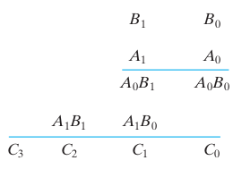

### Demo

The Demo shows the 2-bit multiplier, built from AND gates, XOR gates and AND gates (the half adders).

1. The demo starts with A1A0 = 11 and B1B0 = 10 (3 × 2). Click on an input bit to change its value between 0 and 1.
2. Click on **Start**. The input values travel through the circuit, gate by gate, and the output bits C3C2C1C0 show the product. The same button pauses and resumes the run, and the speed can be changed (1x, 2x, 4x) while it runs.
3. When the run has finished, change the inputs and click on **Start** again. **Reset** brings the circuit back to its starting values.

For example, for A = 11 (3) and B = 10 (2) the product is C3C2C1C0 = 0110 (6).

### Practice

The Practice page has four tasks, one for each tab. In every task the input bits and the output bits are already on the circuit board, and you build the multiplier between them. Submit checks the product for **every** combination of the inputs (16 combinations for the 2-bit multiplier and 256 for the 4-bit multipliers) and shows the expected and the observed product for each of them. It checks the product, not the structure of the circuit.

#### General instructions

- Click on a component in the **Components** panel to add it to the board, drag it to move it, and connect components by dragging from one endpoint (the dots) to another. A wire can be dragged from an output point to an input point or the other way round. An output point can drive several inputs; an input point takes one wire only.
- A **Half Adder** has the inputs A and B (upper and lower) and two outputs: the **Sum** (upper) and the **Carry** (lower). A **Full Adder** has three inputs and the same two outputs, Sum (upper) and Carry (lower).
- To delete a wire or a component, right click on it and select **Delete**.
- Click on an input bit to toggle it between 1 and 0 (the input bits start with the value 1). Click on **Simulate** to see the output bits for the input values that are set. Submit shows its own truth table.
- Click on **Submit** to check the circuit. A "Success" or "Fail" message and a table with the expected and the observed product are shown. The circuit must be completely connected, otherwise the component that is not connected properly is highlighted.

#### Task 1: 2-Bit Binary Multiplier

_Figure 1: The partial products of the multiplication of the 2-bit numbers A1A0 and B1B0. Reference: Theory section_

**Components required:** 4 AND gates and 2 Half Adders. On the board the inputs are A1, A0, B1, B0 and the outputs C3, C2, C1, C0.

**Circuit connections:**

1. Drag the first AND gate and connect its inputs to A0 and B0. This is the partial product P00 = A0·B0.
2. Drag the second AND gate and connect its inputs to A0 and B1 (P01 = A0·B1).
3. Drag the third AND gate and connect its inputs to A1 and B0 (P10 = A1·B0).
4. Drag the fourth AND gate and connect its inputs to A1 and B1 (P11 = A1·B1).
5. Drag the first Half Adder (HA1) and connect its inputs to the outputs of the second AND gate (P01) and the third AND gate (P10). Connect its **Sum** output to the output bit C1.
6. Drag the second Half Adder (HA2) and connect its inputs to the **Carry** output of HA1 and to the output of the fourth AND gate (P11). Connect its **Sum** output to C2 and its **Carry** output to C3.
7. Connect the output of the first AND gate (P00) to the output bit C0.
8. Set the input values and click on "Simulate", then on "Submit".

#### Observations

- The output C3C2C1C0 is the 4-bit product of the 2-bit numbers A1A0 and B1B0.
- For example, for A1A0 = 11 (3) and B1B0 = 10 (2), C3C2C1C0 = 0110 (6).
- If the circuit has been constructed as described above, a "Success" message is displayed upon clicking "Submit".

#### Task 2: 4-Bit Array Multiplier

The product of the 4-bit numbers A3A2A1A0 and B3B2B1B0 is the sum of 16 partial products Pij = Ai·Bj, where Pij has the weight 2^(i+j). On the board the inputs are A3 to A0 and B3 to B0, and the outputs are C7 to C0.

**Components required:** 16 AND gates, 8 Full Adders and 4 Half Adders.

**Circuit connections:**

1. Drag 16 AND gates and connect the inputs of each one to Ai and Bj, to generate the partial products Pij = Ai·Bj for i, j = 0 to 3.
2. Add the partial products column by column, starting with the column of weight 1 (P00 is alone in the column of weight 0 and goes straight to C0). Use the adders of the following table. K is the Carry output of an adder and S is its Sum output, and the number is the number of the adder; for example K1 is the Carry of HA1. The Sum output of the adders marked with a C goes to the output bit with that name.

| Weight | Adder | Inputs         | Sum goes to | Carry goes to |
| ------ | ----- | -------------- | ----------- | ------------- |
| 0      | -     | P00            | C0          | -             |
| 1      | HA1   | P01, P10       | C1          | K1 (weight 2) |
| 2      | FA2   | P02, P11, P20  | S2 (to HA3) | K2 (weight 3) |
| 2      | HA3   | K1, S2         | C2          | K3 (weight 3) |
| 3      | FA4   | P03, P12, P21  | S4 (to HA6) | K4 (weight 4) |
| 3      | FA5   | P30, K2, K3    | S5 (to HA6) | K5 (weight 4) |
| 3      | HA6   | S4, S5         | C3          | K6 (weight 4) |
| 4      | FA7   | P13, P22, P31  | S7 (to HA9) | K7 (weight 5) |
| 4      | FA8   | K4, K5, K6     | S8 (to HA9) | K8 (weight 5) |
| 4      | HA9   | S7, S8         | C4          | K9 (weight 5) |
| 5      | FA10  | P23, P32, K7   | S10 (to FA11) | K10 (weight 6) |
| 5      | FA11  | K8, K9, S10    | C5          | K11 (weight 6) |
| 6      | FA12  | P33, K10, K11  | C6          | K12 (weight 7) |
| 7      | -     | K12            | C7          | -             |

3. Set the input values, click on "Simulate" and observe C7C6C5C4C3C2C1C0, then click on "Submit".

#### Observations

- The output C7C6C5C4C3C2C1C0 is the 8-bit product of the two 4-bit numbers.
- Maximum product: 15 × 15 = 225 = 11100001₂.
- Every carry has to be connected to the adder of the next weight, otherwise the product is wrong for the inputs that produce a carry.
- If the circuit has been constructed correctly, a "Success" message is displayed upon clicking "Submit".

#### Task 3: 4-Bit Advanced Multiplier

This task has the same 16 AND gates and the same column-wise addition as the array multiplier, and the same board. In addition to the Half Adders and Full Adders, the palette has the gates NOT, OR and XOR, so that you can build the adders yourself:

- Half Adder: Sum = A XOR B, Carry = A AND B.
- Full Adder: Sum = A XOR B XOR Cin, Carry = (A AND B) OR (Cin AND (A XOR B)).

**Circuit connections:**

1. Generate the 16 partial products with AND gates, as in Task 2.
2. Add them column by column as in the table of Task 2, using Half Adders and Full Adders, or building some or all of them from XOR, AND and OR gates.
3. Connect the Sum outputs of the last adders of every column to C0 to C7, set the input values, click on "Simulate" and "Submit".

#### Observations

- The product is the same as for the array multiplier, so the truth table is the same.
- The adders built from gates need more components than the adder blocks, which shows the cost of a full adder in gates: 2 XOR, 2 AND and 1 OR.
- If the circuit has been constructed correctly, a "Success" message is displayed upon clicking "Submit".

#### Task 4: Wallace Tree Multiplier

In a Wallace tree the partial products of each column are first reduced by **Full Adders** used as 3:2 compressors (three bits of one weight give one Sum bit of the same weight and one Carry bit of the next weight), stage after stage, until at most two bits are left in each column. Then the two remaining rows are added with a ripple carry adder. The palette has the AND, OR, XOR, NOT, NAND and NOR gates, the Half Adder and the Full Adder.

**Components required:** 16 AND gates, 8 Full Adders and 4 Half Adders.

**Circuit connections:**

1. Generate the 16 partial products Pij = Ai·Bj with AND gates, as in Task 2. P00 goes to C0.
2. Reduce the columns with the Full Adders of the following stages. S is the Sum output and K the Carry output of the adder with that number.

| Stage | Adder | Inputs         | Sum is in weight | Carry goes to weight |
| ----- | ----- | -------------- | ---------------- | -------------------- |
| 1     | FA1   | P02, P11, P20  | 2                | 3                    |
| 1     | FA2   | P03, P12, P21  | 3                | 4                    |
| 1     | FA3   | P13, P22, P31  | 4                | 5                    |
| 2     | FA4   | K1, S2, P30    | 3                | 4                    |
| 2     | FA5   | K3, P23, P32   | 5                | 6                    |
| 3     | FA6   | K4, K2, S3     | 4                | 5                    |

3. Now every weight has at most two bits. Add the two rows with the ripple carry adder, from the lowest weight to the highest:

| Weight | Adder | Inputs        | Sum goes to | Carry goes to |
| ------ | ----- | ------------- | ----------- | ------------- |
| 1      | HA7   | P01, P10      | C1          | K7 (weight 2) |
| 2      | HA8   | S1, K7        | C2          | K8 (weight 3) |
| 3      | HA9   | S4, K8        | C3          | K9 (weight 4) |
| 4      | HA10  | S6, K9        | C4          | K10 (weight 5) |
| 5      | FA11  | K6, S5, K10   | C5          | K11 (weight 6) |
| 6      | FA12  | K5, P33, K11  | C6          | K12 (weight 7) |
| 7      | -     | K12           | C7          | -             |

4. Set the input values, click on "Simulate" and observe C7C6C5C4C3C2C1C0, then click on "Submit".

#### Observations

- The partial products of all the columns are reduced at the same time in the stages, so the number of stages (3 here) grows only with the logarithm of the number of rows, instead of with the number of rows as in the array multiplier.
- The final ripple carry adder still limits the speed. In large multipliers a faster adder is used for the last step.
- The product is the same as for the array multiplier, so the truth table is the same.
- If the circuit has been constructed correctly, a "Success" message is displayed upon clicking "Submit".

#### Troubleshooting

- **"Highlighted component not connected properly"**: every input of every component has to be connected, and every component output has to drive something (an adder with an unused Carry output is fine as long as its Sum is used, but a component with no connected output at all is not).
- **Only some rows of the table fail**: usually a Carry output has been connected to the wrong adder, or the Sum of an adder has been used where its Carry is needed. The adders show the Sum on the upper output and the Carry on the lower one.
